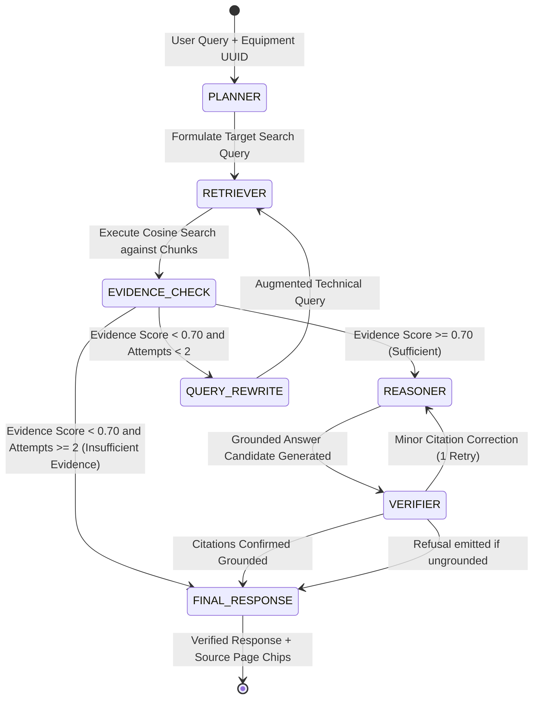

# Agentic RAG Architecture: LangGraph Backend & Mobile Dart Orchestration

## 1. Traditional RAG vs. Agentic RAG

| Characteristic | Traditional RAG | EdgeRAG Agentic RAG |
|---|---|---|
| **Query Handling** | Passes raw user prompt directly into vector index | Planner extracts entities, equipment model, and intent before retrieval |
| **Retrieval Feedback** | Single-shot retrieval; returns top-k whether relevant or not | Evaluates evidence relevance; executes bounded query reformulation if evidence is weak |
| **Tool Execution** | Fixed pipeline; no tool invocation | Dynamic Tool Controller (retrieves chunks, checks equipment spec, verifies page tables) |
| **Hallucination Control** | Pure prompt engineering ("Answer based only on...") | Explicit Verifier Node checks claim-to-citation alignment before emitting response |
| **State Machine** | Linear procedural script | Stateful cyclic graph with typed checkpoints (LangGraph on Server, Dart FSM on Mobile) |

---

## 2. Server-Side LangGraph Workflow (`services/api/app/ai`)



### Graph State Definition (`EdgeRagAgentState`)
```python
class EdgeRagAgentState(TypedDict):
    request_id: str
    equipment_id: str
    equipment_name: str
    user_query: str
    current_search_query: str
    query_attempt: int               # Bounded: maximum 2 reformulations
    retrieved_chunks: List[dict]     # Chunks with page_number, score, text
    evidence_status: str             # SUFFICIENT | INSUFFICIENT
    selected_tools: List[str]
    provider: str                    # gemini-1.5-flash | claude-3-5-sonnet | local
    generated_answer: str
    verified_citations: List[dict]
    final_status: str                # SUCCESS | INSUFFICIENT_EVIDENCE | ERROR
    observable_events: List[str]     # Diagnostic execution trace
    error: Optional[str]
```

---

## 3. The 7 LangGraph Nodes Explained

1. **Planner Node**:
   - Parses the engineer's raw input.
   - Verifies the selected equipment ID against MySQL metadata.
   - Identifies specific technical sub-systems (e.g., "hydraulic pump", "emergency stop circuit").
   - Outputs the targeted initial retrieval query.
2. **Retriever Node**:
   - Embeds the search query using `all-MiniLM-L6-v2` (384-d).
   - Computes cosine similarity against the active equipment's chunks in SQLite / vector memory.
   - Filters chunks below the similarity threshold (0.50).
   - Ranks and extracts top-4 candidate passages with source page numbers.
3. **Evidence Check & Query Rewriter Node**:
   - Assesses chunk relevance and technical density.
   - If chunks are generic or below threshold: rewrites query using technical synonym expansion (e.g., "motor shutdown" $\to$ "emergency thermal cutoff switch wiring diagram").
   - Strictly bounded to **2 retries** to guarantee low latency and prevent infinite loops.
4. **Tool Controller Node**:
   - Coordinates deterministic helper tools:
     - `get_equipment_spec(equipment_id)`
     - `fetch_adjacent_manual_page(manual_id, page_number)`
     - `verify_fault_code(error_code)`
5. **Reasoner Node**:
   - Dispatches prompt containing:
     - System role: Industrial Safety Diagnostic Assistant.
     - Strict grounding constraint: Only make assertions directly backed by provided manual chunks.
     - Mandated citation tags: Every factual step must conclude with `[Page X]`.
   - Calls the configured active provider (e.g., Google Gemini 1.5 Flash).
6. **Verifier Node**:
   - Scans the generated answer text for citations.
   - Validates that referenced pages exist within the actually retrieved chunks.
   - Flags hallucinations or claims unsupported by the chunk text.
7. **Final Response Node**:
   - Formats the clean response, attaches verified clickable page citations, and packages the complete execution trace for developer auditability.

---

## 4. Mobile On-Device Agent Architecture (Dart FSM)

LangGraph is a Python framework and cannot run on an air-gapped Android device without Python. EdgeRAG solves this by implementing a **mirror Finite State Machine (FSM)** in pure Dart inside the Flutter application (`services/agent_controller.dart`).

```
Mobile Engineer (Offline Air-Gap)
       |
       v
+-------------------------------------------------------------+
| Dart AgentController (Bounded Mobile State Machine)         |
|                                                             |
|  1. Local Query Planner (regex & entity extraction)         |
|  2. Local Vector Matcher (384-d dot product against SQLite) |
|  3. Sufficiency Check (Cosine score >= 0.65)                |
|  4. Local Query Rewriter (Max 2 retries)                    |
|  5. llama.cpp / On-device GGUF Runtime                     |
|  6. Citation Grounding Verifier                             |
|  7. Stream Tokens to UI & Render Page Citation Chips        |
+-------------------------------------------------------------+
```

### Observable Trace Example
```text
[PLANNER] Identified equipment: Siemens S7-1500 PLC (UUID: 3fa85f64...)
[RETRIEVER] Vector similarity search executed against 142 local chunks
[RETRIEVER] Selected Top 3 chunks: [Chunk 14: Page 22 (0.88), Chunk 15: Page 23 (0.81), Chunk 28: Page 45 (0.76)]
[EVIDENCE] Relevance threshold met (0.88 >= 0.70)
[TOOL] Verified manual revision: Rev 4.1
[REASONER] Invoking Gemini 1.5 Flash with grounded evidence context
[RESULT] Emitted 284 tokens with 2 verified citations
```

---

## 5. Multimodal Agent Skills Framework (On-Device Dart Engine)

EdgeRAG expands the mobile Dart FSM with an **authorized Agent Skills controller** (`AgentSkillsService`):

| Skill Name | Allowed Parameters | Verification & Grounding Check |
|---|---|---|
| `search_equipment_manual` | `equipment_id`, `query` | Cosine similarity ranking over SQLite B-tree chunks |
| `read_manual_page` | `manual_id`, `page_number` | Strict page-bounds check; returns exact Markdown |
| `explain_equipment_error` | `error_code`, `equipment_id` | Alphanumeric fault-code regex; quotes manual diagnosis |
| `analyze_image` | `image_path`, `question` | Multimodal model inspection; extracts visual symptoms |
| `transcribe_audio` | `audio_path` | Noise-suppressed audio parsing; outputs text note |
| `create_incident_draft` | `description`, `equipment_id` | Formats RFC-4122 V4 UUID ticket; **requires explicit technician confirmation** |
| `check_knowledge_readiness` | `equipment_id` | Integrity check of SQLite schema, chunk count, and 384-d vectors |

### Security Boundaries
- **Strict Whitelist**: Any skill identifier not in the static enum throws an immediate safety exception.
- **No Unsafe Execution**: Arbitrary shell commands, dynamic code evaluation, and automated machinery manipulation are architecturally impossible.
- **Untrusted Input Sanitation**: Extracted OCR text and vision observations are treated as untrusted data rather than system instructions to prevent prompt injection.
